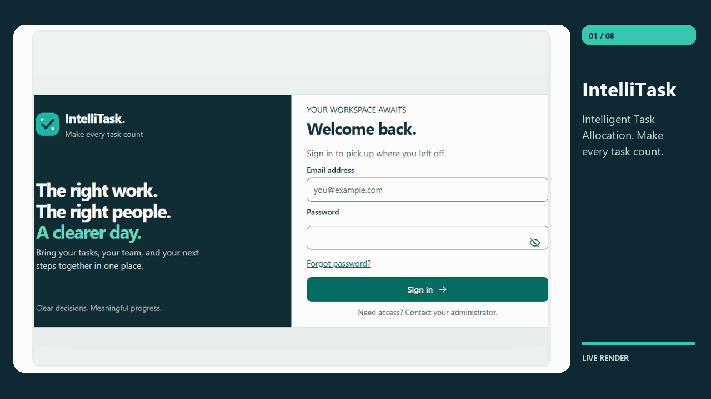
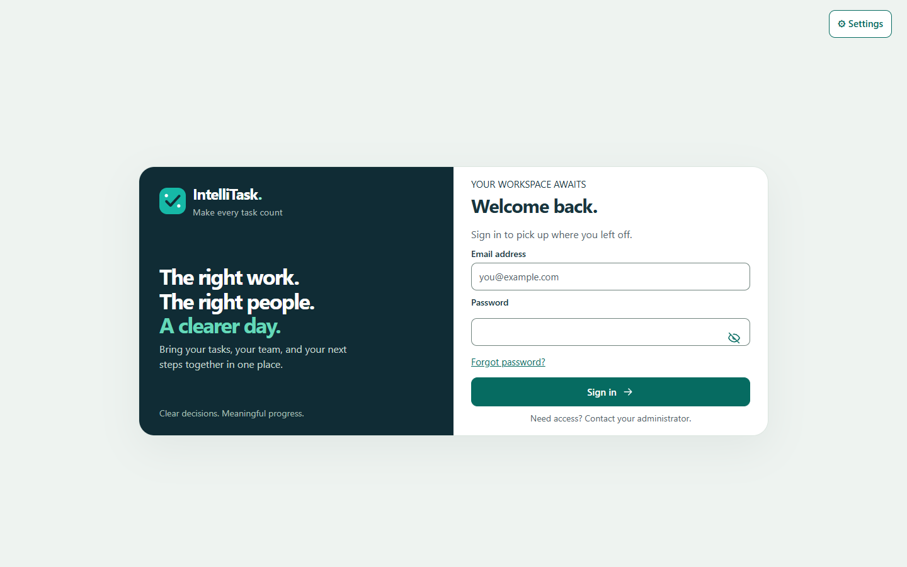
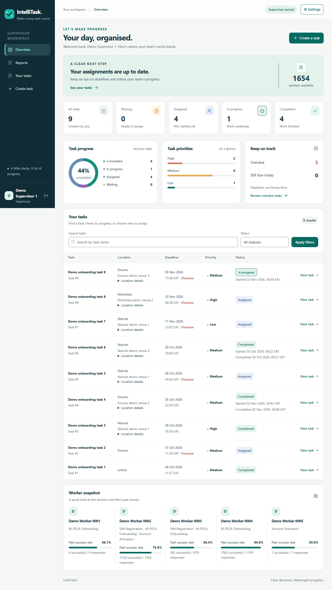
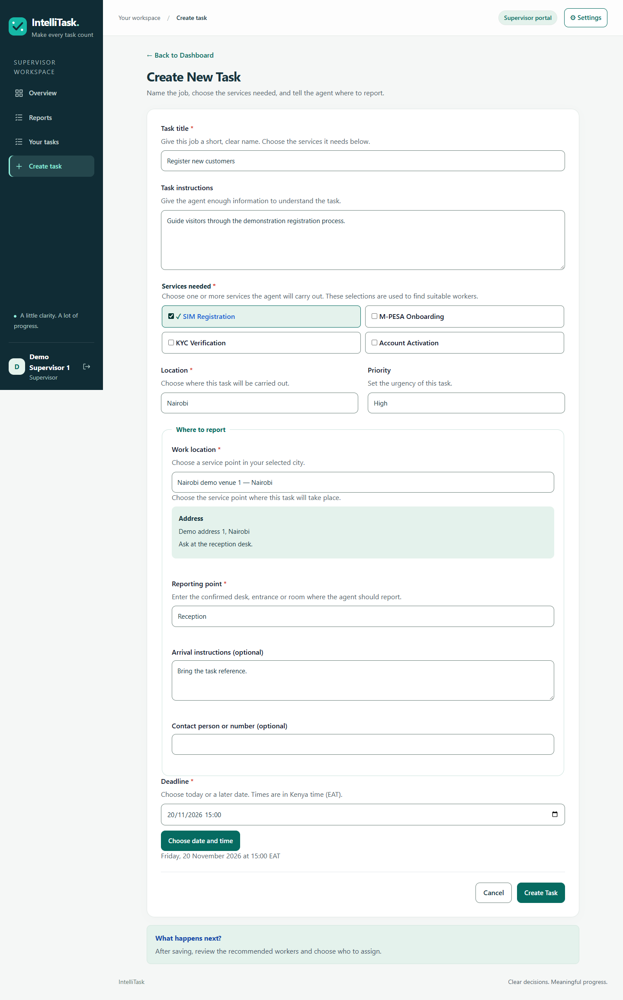
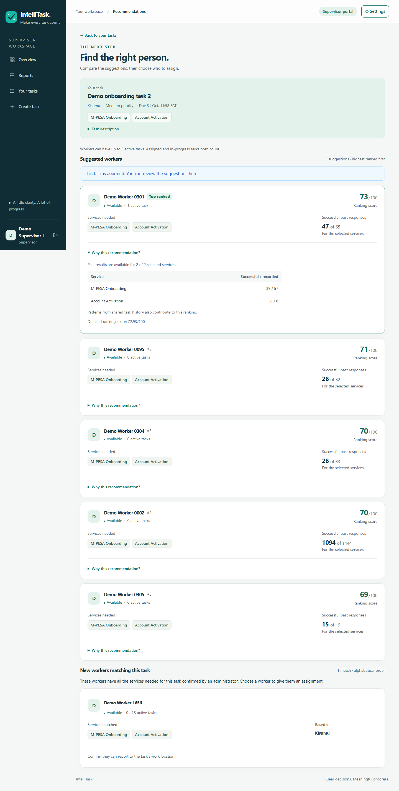
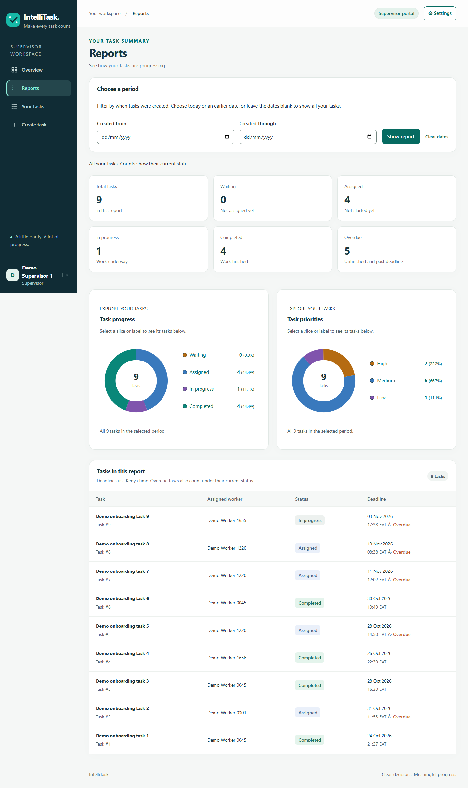
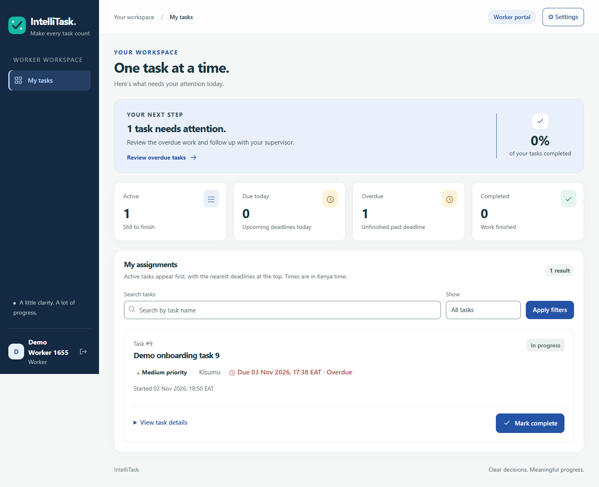
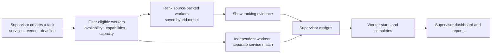
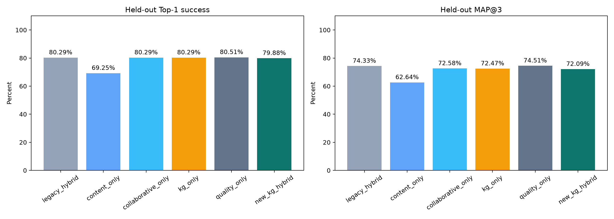
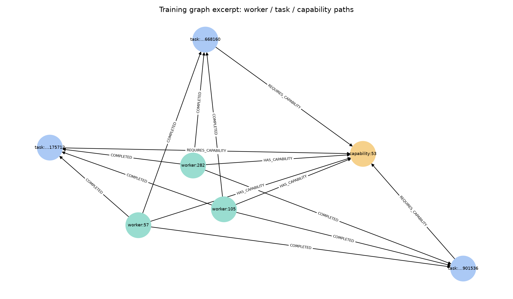

<p align="center">
  
</p>

# IntelliTask

**An Explainable Knowledge Graph-Driven Hybrid Recommender for Intelligent Task Allocation in Distributed Onboarding Operations**

IntelliTask helps supervisors organise tasks, review explainable worker suggestions, assign work, and follow progress. Workers update their assigned tasks; administrators manage accounts, services and work locations. The responsive Flask application combines an operational workflow with a research recommender built from NetEaseCrowd data.

<p>
  <a href="https://intellitask-v5nc.onrender.com/auth/login"></a>
  &nbsp; <a href="https://github.com/Sagooparneet/task-allocation-recommender">Source code</a>
  &nbsp; <a href="#documentation">Documentation</a>
</p>

**Access:** the hosted site requires an approved account. It does not offer open registration. The HTTPS login page was accessible during this documentation review; the authenticated screens below were captured from a disposable local installation. [Deployment verification and limits](docs/DEPLOYMENT_STATUS.md).

## Application preview

<a href="docs/media/intellitask-preview.gif"></a>

[View a static preview](docs/media/intellitask-preview.png) · [Open the screenshot collection](docs/media/README.md) · [Launch IntelliTask](https://intellitask-v5nc.onrender.com/auth/login)

The animation uses genuine browser captures. Only the login and responsive views came from Render; protected views use anonymised records in a disposable local copy. No production workflow was changed to make it.

## Explore IntelliTask

[Features](#key-features) · [Screenshots](#application-screenshots) · [Workflow](#how-intellitask-works) · [Recommendation engine](#recommendation-architecture) · [Evaluation](#model-evaluation) · [Technology](#technology-stack) · [Getting started](#getting-started) · [Deployment](#deployment) · [Testing](#testing) · [Documentation](#documentation) · [Limitations](#limitations)

## Project overview

Distributed onboarding work needs a clear way to define a task, choose an available person with relevant services, communicate where to report, and track completion. IntelliTask puts those steps in role-specific workspaces. Supervisors make the allocation decision; the recommender ranks eligible dataset-backed workers and shows evidence behind its suggestions. Independently added workers appear in a separate service-matching list without borrowed dataset scores.

The NetEaseCrowd experiment is **research evidence**, not a record of live onboarding outcomes. The retained sample contains **121,201 task-worker observations, 17,987 source tasks and 1,653 source workers**. Application task counts and reports come from IntelliTask's own database.

## Key features

| Role or area | Implemented workflow |
|---|---|
| **Supervisor** | Task overview, search and filters; create tasks with services, venue, priority and deadline; inspect recommendations and explanations; assign a worker; monitor task progress and interactive reports. |
| **Worker** | View assignments, saved location details and deadlines; start assigned work; mark in-progress work complete. |
| **Administrator** | Manage workers, supervisors, work locations, availability, services and account access; issue initial setup invitations. |
| **Shared interface** | Responsive Bootstrap layout, role colours, keyboard navigation, form errors, appearance and text-size settings, high contrast and reduced-motion preferences. |

These flows are implemented in the repository and were captured locally. Hosted rollout of each authenticated feature must be verified separately. The current hosted login capture does **not** show a Google button; that button requires a configured sign-in OAuth client. Gmail sending on a Windows local installation is separate from hosted email delivery.

## Application screenshots

Each preview links to the full browser capture. Names, addresses and task instructions in the local screens are synthetic showcase values.

<table>
  <tr>
    <td><a href="docs/media/screens/01-login.png"></a><br><strong>Hosted sign-in</strong><br>Live Render login, captured at 1440 × 900.</td>
    <td><a href="docs/media/screens/02-supervisor-dashboard.png"></a><br><strong>Supervisor overview</strong><br>Local task summaries, filters and progress.</td>
  </tr>
  <tr>
    <td><a href="docs/media/screens/03-create-task.png"></a><br><strong>Create a task</strong><br>Local form filled with synthetic demonstration details.</td>
    <td><a href="docs/media/screens/04-recommendations.png"></a><br><strong>Worker recommendations</strong><br>Local saved-model ranking and inspectable evidence.</td>
  </tr>
  <tr>
    <td><a href="docs/media/screens/05-supervisor-reports.png"></a><br><strong>Progress reports</strong><br>Local totals, charts and task drill-down.</td>
    <td><a href="docs/media/screens/06-worker-dashboard.png"></a><br><strong>Worker tasks</strong><br>Local assignment and completion controls.</td>
  </tr>
</table>

<details>
<summary>More screens: administrator workspace and responsive sign-in</summary>

Administrator: [overview](docs/media/screens/07-admin-dashboard.png), [workers](docs/media/screens/10-admin-workers.png), [supervisors](docs/media/screens/11-admin-supervisors.png), [work locations](docs/media/screens/12-admin-venues.png).

Hosted responsive sign-in: [tablet](docs/media/screens/09-login-tablet.png) and [mobile](docs/media/screens/08-responsive-mobile.png).

</details>

## How IntelliTask works



The supervisor chooses who receives a task. The assignment and workload update together. Starting work records a timestamp; completion records another and releases one active workload slot. The worker capacity limit is three active assignments. Website activity does not retrain the saved model.

## Recommendation architecture

The active configuration combines **10% content-based**, **50% collaborative** and **40% knowledge-graph** signals. Content features describe source task/worker capability relationships; collaborative features use historical source interactions; graph features use saved worker–task–capability paths. The server loads saved artifacts for inference, applies explicit source-worker and capability mappings, checks availability and capacity, then displays ranked workers with explanation evidence.

The graph was built from training records only. Its explanation panel reports recorded source responses and relationships; a ranking score is **not** a probability that someone will succeed on a real onboarding task. Administrator-added independent workers use service matching instead of model ranking. [Evaluation method and provenance](ml/reports/VERIFIED_RESULTS.md) · [Historical implementation details](docs/IMPLEMENTATION_HISTORY.md).

## Model evaluation

Results below come from the [verified report](ml/reports/VERIFIED_RESULTS.md) and [machine-readable evaluation](ml/reports/final_evaluation.json). They rank observed participants on held-out **NetEaseCrowd** tasks; they do not measure real onboarding allocations.

| Recorded model | Top-1 success | MAP@3 |
|---|---:|---:|
| Content only | 69.248% | 62.635% |
| Collaborative only | 80.289% | 72.579% |
| Knowledge graph only | 80.289% | 72.474% |
| Historical quality baseline | **80.511%** | **74.511%** |
| Preserved legacy hybrid | 80.289% | 74.331% |
| **Current knowledge-graph hybrid** | 79.881% | 72.093% |

The current hybrid **does not outperform** the historical-quality baseline on these recorded test metrics. Its weights were chosen on validation MAP@3; earlier inspection of the test split makes the architecture comparison retrospective rather than a new blind evaluation.

<a href="ml/reports/figures/final_comparison.png"></a>

<details>
<summary>View the training knowledge-graph excerpt</summary>

<a href="ml/reports/figures/knowledge_graph.png"></a>

</details>

## Technology stack

| Layer | Technologies |
|---|---|
| Application | Python 3.13, Flask, Jinja2, SQLAlchemy, Flask-Migrate/Alembic |
| Interface | HTML, CSS, JavaScript, pinned Bootstrap 5.3.8 assets |
| Recommendation | Saved content, collaborative and knowledge-graph artifacts; Python inference services |
| Data | SQLite for local installations; PostgreSQL on Neon for the hosted installation |
| Hosting | Render with Gunicorn and `wsgi:app` |
| Verification | pytest, Node.js frontend tests, browser captures, database migration checks |

## Getting started

Use Python 3.13. These commands set up a **new local research/demo installation**; they do not import the author's private local database or provision every administrator and venue workflow.

```powershell
git clone https://github.com/Sagooparneet/task-allocation-recommender.git
cd task-allocation-recommender
python -m venv venv
venv\Scripts\Activate.ps1
python -m pip install -r requirements.txt
python seed.py --instance-dir instance/netease_setup_test --check-only
python seed.py --instance-dir instance/netease_setup_test
python run_netease_test.py
```

The seed prompts privately for the initial supervisor. It creates source-backed demo workers and their installation-specific bindings, but no administrator, task, assignment or venue directory. Review schema history and provision venues before using the full task workflow. **Do not reuse** a binding file with a different database or rerun initialization on an existing installation. [Detailed setup and migration notes](docs/IMPLEMENTATION_HISTORY.md#account-bootstrap-for-a-fresh-installation-windows-powershell).

## Deployment

[Launch IntelliTask](https://intellitask-v5nc.onrender.com/auth/login) opens the HTTPS sign-in page on Render. The hosted application uses Neon PostgreSQL; saved recommendation artifacts ship with the application code. Render's free service can need a cold start after inactivity.

| Verification boundary | Current evidence |
|---|---|
| Live public page | HTTPS sign-in returned successfully and was captured at desktop, tablet and mobile widths. |
| Protected workflows | The screenshot gallery verifies these against a disposable local copy. This documentation pass did not authenticate to the hosted portals. |
| Google sign-in | The current hosted login capture has no Google button; the local code supports it when a separate OAuth client is configured. |
| Email delivery | Local Gmail authorization uses Windows-protected credentials that cannot be reused by Render. Hosted invitations and recovery require separate provider setup and delivery checks. |

Neon migrations and selected account/task import were performed in the preceding deployment work; that history is **not** proof that every hosted route works today. See [deployment status](docs/DEPLOYMENT_STATUS.md) for the exact boundary. Do not run local SQLite upgrade helpers against Neon, commit connection strings, or run seeding in a Render build/start command.

## Testing

```powershell
python -m pytest tests ml/tests -q
node --test tests/js/accessibility_preferences.test.cjs tests/js/deadline_calendar.test.cjs tests/js/worker_setup.test.cjs
python -m pip check
```

The previous README records **433 Python tests and 16 JavaScript tests passing** in a local run. This documentation-only change does not claim a fresh full-suite run. The checks for this PR validate links, media, metrics, changed-file scope and `git diff --check`; their actual outcomes are reported in the pull request.

## Project structure

```text
app/                  Flask routes, models, services, templates and assets
docs/                 Feature guides, implementation history and showcase media
ml/data/              NetEaseCrowd source and processed research records
ml/models/netease/    Saved inference artifacts
ml/notebooks/         Six research notebooks
ml/reports/           Verified metrics and figures
ml/src/               Training, evaluation and inference code
migrations/           Versioned database migrations
scripts/              Setup and controlled verification utilities
tests/                Flask and frontend tests
instance/             Local installation data (not committed)
```

## Documentation

- [Detailed implementation history](docs/IMPLEMENTATION_HISTORY.md) — original setup, migration, role, authentication, accessibility and research notes, retained as a historical record.
- [Deployment status](docs/DEPLOYMENT_STATUS.md) — verified live/local boundary and operational cautions.
- [Screenshot and GIF provenance](docs/media/README.md) — source, dimensions and construction.
- [Research results](ml/reports/VERIFIED_RESULTS.md), [evaluation JSON](ml/reports/final_evaluation.json), [notebooks](ml/notebooks/) and [ML package notes](ml/README.md).
- [Supervisor reports](docs/SUPERVISOR_REPORTS.md), [worker matching](docs/INDEPENDENT_WORKER_MATCHING.md), [work locations](docs/TASK_WORK_LOCATIONS.md) and [accessibility settings](docs/SETTINGS_AND_APPEARANCE.md).
- [Local Gmail authorization](docs/GMAIL_LOCAL_AUTHORIZATION.md), [worker password setup](docs/WORKER_PASSWORD_SETUP.md) and [Bootstrap integration](docs/BOOTSTRAP_INTEGRATION.md).

## Limitations

- NetEaseCrowd is a proxy dataset. Demonstration service labels such as “KYC Verification” do not establish that source capability codes represent real onboarding qualifications. Imported worker names are aliases.
- Historical recommendation evidence and scores describe the source training sample. Application task progress is separate, and completion does not retrain the model.
- The active hybrid trails the historical-quality baseline on the recorded benchmark. The comparison is retrospective; production effectiveness and fairness on real onboarding work remain unproven.
- The gallery proves local protected-page rendering with anonymised data and live public-login rendering only. Hosted Google sign-in, Gmail delivery and the complete authenticated workflow need independent deployment checks.
- Settings support keyboard use and user preferences, but a screen-reader audit and broad device/browser review are still needed before claiming accessibility conformance.

## Dataset attribution

The research data comes from the [official NetEaseCrowd dataset repository](https://github.com/fuxiAIlab/NetEaseCrowd-Dataset). The project retains its source files, license and hash manifest under `ml/data/raw/netease/`. Preserve the upstream attribution and license when redistributing the data.
